# EDA Findings – Observation · Insight · Evidence · Limitation

> Observation do code tự sinh từ dữ liệu train+valid (tập test được giữ kín).
> **Insight phải do nhóm viết**: nối observation với một quyết định của stakeholder.
> Không dùng từ 'gây ra', 'tác động', 'sinh viên yếu'.

Số biểu đồ: **11**

## 1. AQ1 – Tỷ lệ hoàn thành / Fail / Withdrawn theo lượt giảng dạy?

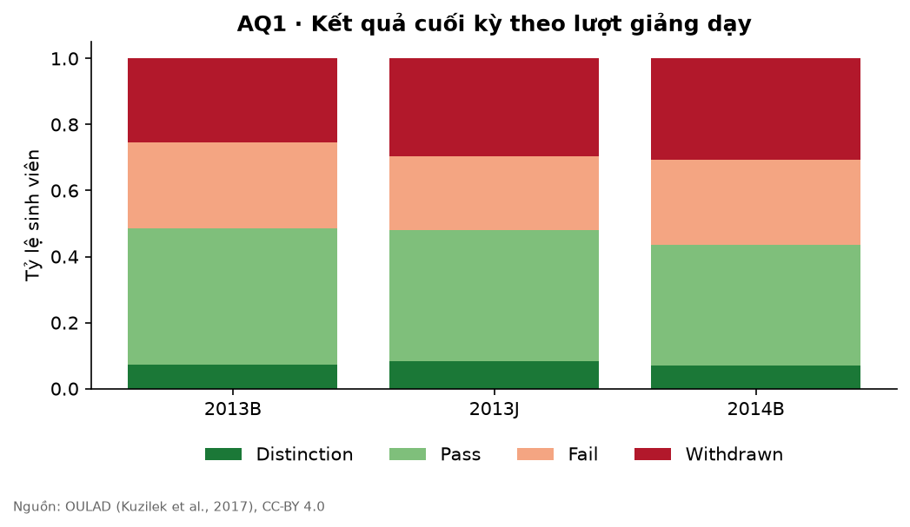

| | |
|---|---|
| **Observation** | Completion rate theo lượt: 2013B 48.5%, 2013J 48.0%, 2014B 43.6%. Toàn bộ: 46.9% (n=5397). |
| **Insight** | TODO (nhóm viết: điều này có nghĩa gì cho quyết định của ai?) |
| **Evidence** | `reports/figures/aq1_outcomes_by_presentation.png` |
| **Limitation** | Dữ liệu Anh 2013–2014; baseline 60% trong proposal là assumption, cần cập nhật theo số này. |

## 2. AQ1 – Rút môn diễn ra vào tuần nào? Còn bao nhiêu % rút sau Tuần 6?

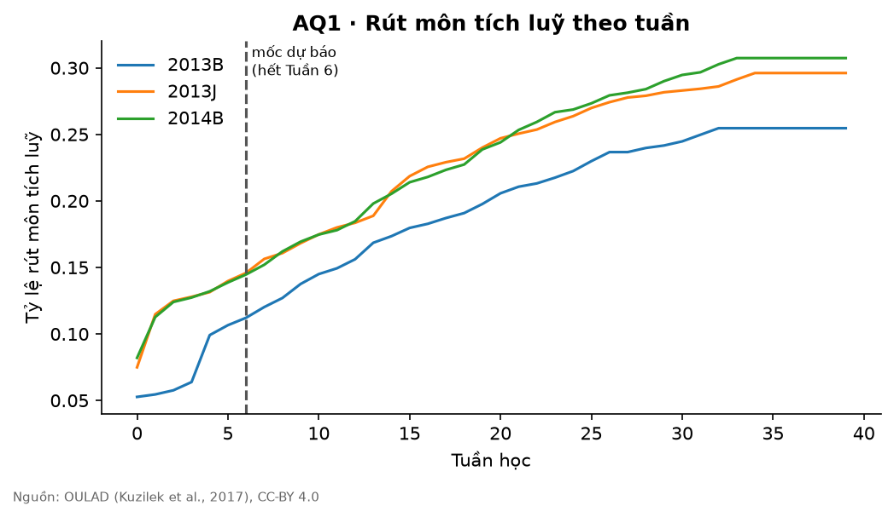

| | |
|---|---|
| **Observation** | Trong số sinh viên rút môn, tỷ lệ rút SAU mốc dự báo: 2013B 56%, 2013J 51%, 2014B 53% → đây là cửa sổ còn can thiệp được. |
| **Insight** | TODO (nhóm viết: điều này có nghĩa gì cho quyết định của ai?) |
| **Evidence** | `reports/figures/aq1_cumulative_withdrawal.png` |
| **Limitation** | Ngày rút môn có thể là ngày ghi nhận hành chính, không phải ngày thực sự ngừng học. |

## 3. AQ2 – Tương tác VLE phân bố thế nào theo tuần và loại tài nguyên?

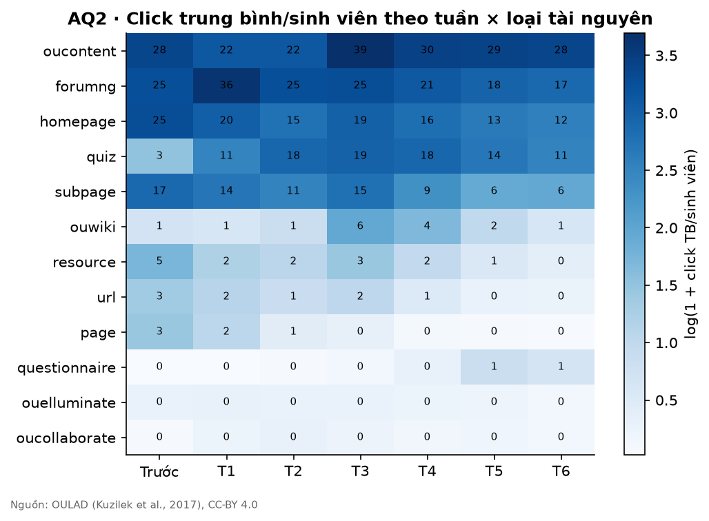

| | |
|---|---|
| **Observation** | 3 loại tài nguyên nhiều click nhất: oucontent (199 click/SV), forumng (168 click/SV), homepage (119 click/SV). |
| **Insight** | TODO (nhóm viết: điều này có nghĩa gì cho quyết định của ai?) |
| **Evidence** | `reports/figures/aq2_heatmap_week_activity.png` |
| **Limitation** | Click là proxy của tương tác, không đo được chất lượng học (góp ý của Lecturer). |

## 4. AQ2 – Mức tương tác của lớp thay đổi thế nào qua từng tuần?

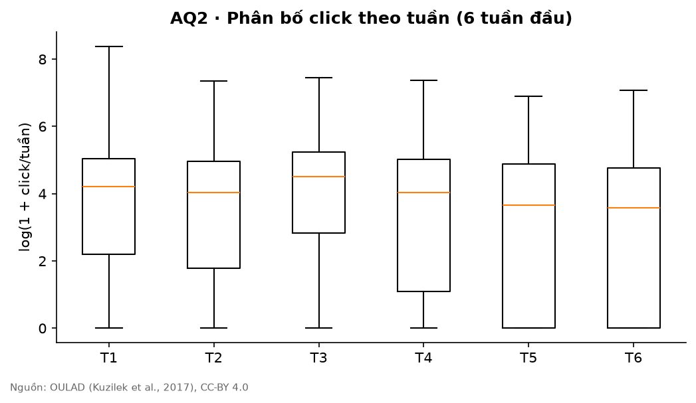

| | |
|---|---|
| **Observation** | Tỷ lệ sinh viên 0 click: T1 19%, T2 21%, T3 19%, T4 23%, T5 26%, T6 28%. |
| **Insight** | TODO (nhóm viết: điều này có nghĩa gì cho quyết định của ai?) |
| **Evidence** | `reports/figures/aq2_clicks_by_week_box.png` |
| **Limitation** | Tổng hợp theo tuần làm mất dao động trong tuần. |

## 5. AQ3 – Tỷ lệ nộp đúng hạn / muộn / không nộp từng bài đầu kỳ?

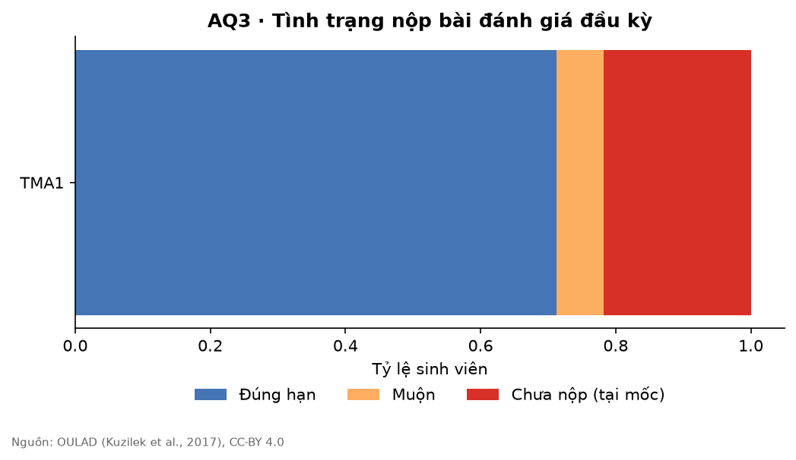

| | |
|---|---|
| **Observation** | Tỷ lệ chưa nộp tại mốc: TMA1 22%. |
| **Insight** | TODO (nhóm viết: điều này có nghĩa gì cho quyết định của ai?) |
| **Evidence** | `reports/figures/aq3_submission_status.png` |
| **Limitation** | Bài nộp sau ngày 41 bị tính là 'chưa nộp' vì chưa quan sát được tại mốc dự báo. |

## 6. AQ3 – Điểm trung vị và phân bố điểm của từng bài đầu kỳ?

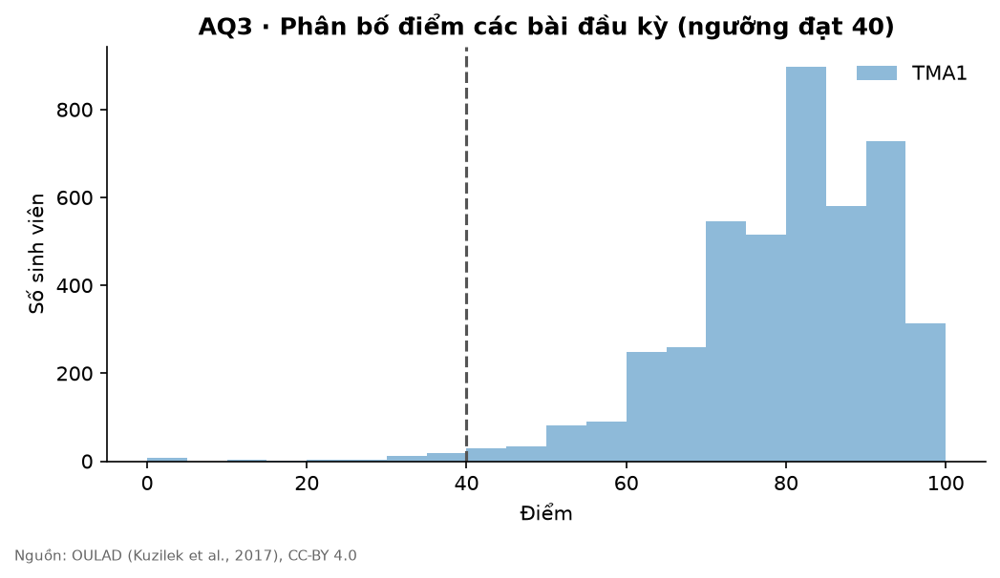

| | |
|---|---|
| **Observation** | Điểm trung vị: TMA1 82. |
| **Insight** | TODO (nhóm viết: điều này có nghĩa gì cho quyết định của ai?) |
| **Evidence** | `reports/figures/aq3_score_distribution.png` |
| **Limitation** | Chỉ tính bài đã nộp; sinh viên không nộp không xuất hiện trong histogram. |

## 7. AQ4 – Chỉ báo engagement Tuần 1–6 khác biệt đến mức nào giữa hai nhóm?

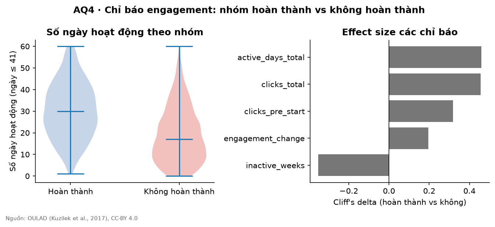

| | |
|---|---|
| **Observation** | Chỉ báo khác biệt lớn nhất (Cliff's δ, p Holm): active_days_total δ=0.46 (vừa), p=1.1e-160; clicks_total δ=0.46 (vừa), p=6.7e-158; inactive_weeks δ=-0.35 (vừa), p=4.4e-132. |
| **Insight** | TODO (nhóm viết: điều này có nghĩa gì cho quyết định của ai?) |
| **Evidence** | `reports/figures/aq4_engagement_by_outcome.png` |
| **Limitation** | Khác biệt/liên hệ, KHÔNG phải nhân quả. Với n lớn, p nhỏ là dễ – đọc effect size. |

## 8. AQ4 – Đường tương tác của hai nhóm tách nhau từ tuần nào?

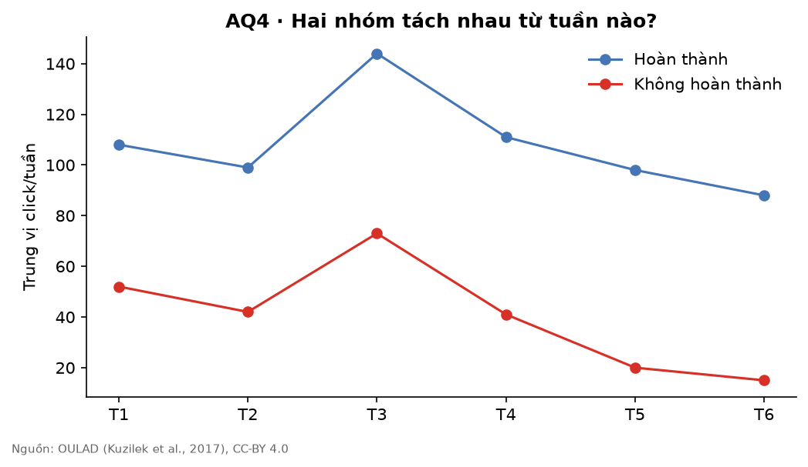

| | |
|---|---|
| **Observation** | Tỷ số trung vị click (không hoàn thành / hoàn thành): T1 0.49, T2 0.43, T3 0.51, T4 0.38, T5 0.21, T6 0.18. |
| **Insight** | TODO (nhóm viết: điều này có nghĩa gì cho quyết định của ai?) |
| **Evidence** | `reports/figures/aq4_weekly_median_clicks.png` |
| **Limitation** | Trung vị che khuất sự đa dạng trong từng nhóm. |

## 9. AQ5 – Điểm bài đầu tiên liên hệ thế nào với khả năng hoàn thành?

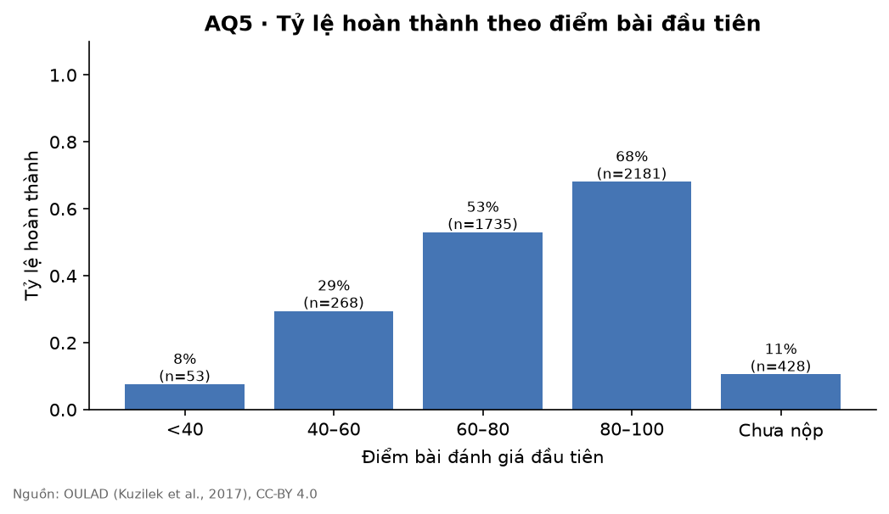

| | |
|---|---|
| **Observation** | Tỷ lệ hoàn thành: <40 8%, 40–60 29%, 60–80 53%, 80–100 68%, Chưa nộp 11%. |
| **Insight** | TODO (nhóm viết: điều này có nghĩa gì cho quyết định của ai?) |
| **Evidence** | `reports/figures/aq5_completion_by_first_score.png` |
| **Limitation** | Liên hệ, không nhân quả; nhóm 'chưa nộp' gộp nhiều lý do khác nhau. |

## 10. AQ5 – Sau khi điều chỉnh theo engagement, yếu tố bài đánh giá nào còn liên hệ mạnh?

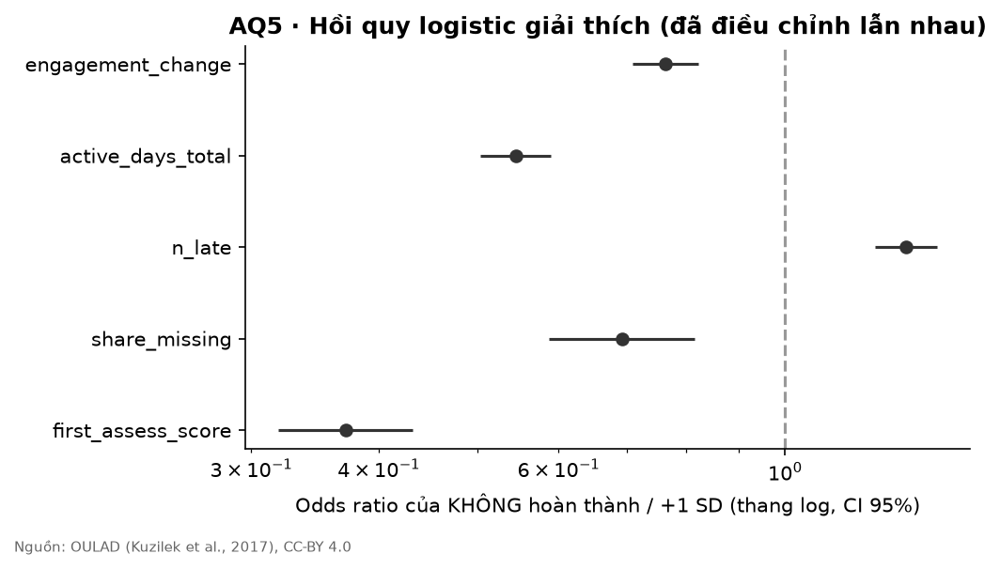

| | |
|---|---|
| **Observation** | OR/SD: first_assess_score 0.37, share_missing 0.69, n_late 1.31, active_days_total 0.54, engagement_change 0.76. Pseudo R² = 0.184. |
| **Insight** | TODO (nhóm viết: điều này có nghĩa gì cho quyết định của ai?) |
| **Evidence** | `reports/figures/aq5_logit_coefficients.png` |
| **Limitation** | Mô hình giải thích, không phải dự báo; các biến tương quan nhau nên hệ số có thể không ổn định. |

## 11. AQ6 – Concept/CLO nào nhiều sinh viên cần hỗ trợ thêm nhất?

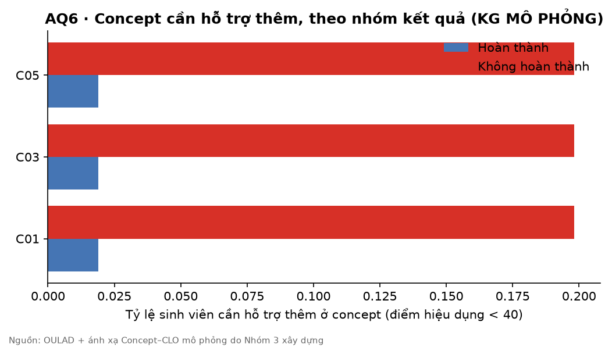

| | |
|---|---|
| **Observation** | Concept có tỷ lệ cần hỗ trợ cao nhất ở nhóm không hoàn thành: C01 20%, C03 20%, C05 20%. |
| **Insight** | TODO (nhóm viết: điều này có nghĩa gì cho quyết định của ai?) |
| **Evidence** | `reports/figures/aq6_concept_gaps.png` |
| **Limitation** | Ánh xạ concept là DỮ LIỆU MÔ PHỎNG và ở mức bài, không phải mức câu hỏi. |
