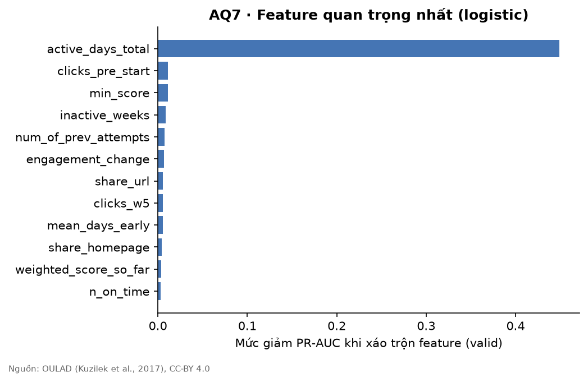

# Explainability Report (tự sinh)

Mô hình chính: **logistic**. SHAP chưa cài (`pip install shap`) – dùng permutation importance.

## Global – Permutation importance (valid, thước đo PR-AUC)

|                       |   importance |
|:----------------------|-------------:|
| active_days_total     |       0.4491 |
| clicks_pre_start      |       0.0111 |
| min_score             |       0.0111 |
| inactive_weeks        |       0.0087 |
| num_of_prev_attempts  |       0.0075 |
| engagement_change     |       0.0067 |
| share_url             |       0.0058 |
| clicks_w5             |       0.0058 |
| mean_days_early       |       0.0054 |
| share_homepage        |       0.004  |
| weighted_score_so_far |       0.0039 |
| n_on_time             |       0.0034 |
| clicks_w1             |       0.0026 |
| clicks_late           |       0.0023 |
| mean_score            |       0.0023 |

## Local – Reason codes

Reason code là luật minh bạch (không phải SHAP), ngưỡng lấy từ tập train, xếp theo
độ quan trọng toàn cục của feature liên quan. Tất cả dùng ngôn ngữ hỗ trợ.

| Feature | Ví dụ câu giải thích |
|---|---|
| `first_assess_missing` | Chưa nộp bài đánh giá đầu tiên – nên hỏi thăm khó khăn |
| `n_missing` | Còn 1 bài đánh giá đầu kỳ chưa nộp |
| `engagement_change` | Hoạt động trên LMS giảm rõ ở Tuần 4–6 so với Tuần 1–3 |
| `active_days_total` | Số ngày học trên LMS (5 ngày) thuộc nhóm 25% thấp nhất lớp |
| `inactive_weeks` | 2 tuần không có hoạt động LMS |
| `mean_score` | Điểm trung bình bài đầu kỳ (35) chưa đạt ngưỡng 40 – cần hỗ trợ thêm |
| `n_late` | Có 1 bài nộp muộn |

> Giới hạn: reason code mô tả tín hiệu dữ liệu, KHÔNG phải nguyên nhân. Cố vấn cần trao đổi với sinh viên để hiểu bối cảnh thật.