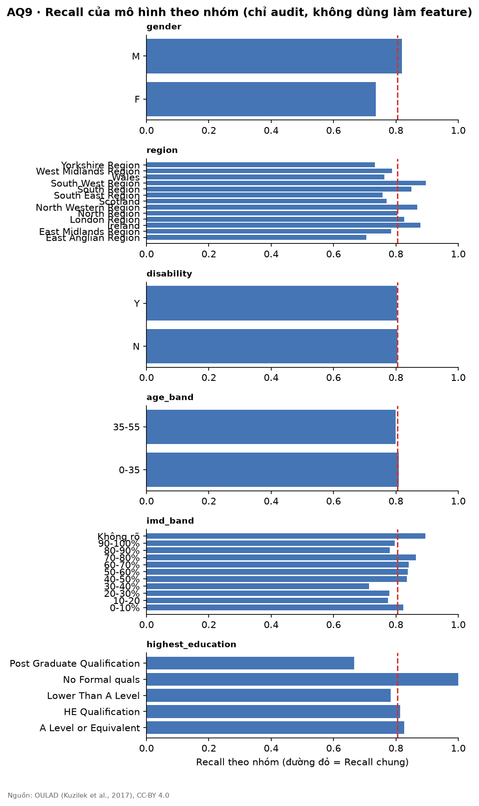

# Fairness Audit – AQ9 (tự sinh)

Tập test, n = 1834. Recall chung = 0.805. Nhóm < 10 sinh viên bị ẩn.

## Chênh lệch Recall lớn nhất theo thuộc tính

| attribute         |   recall_min |   recall_max |   recall_gap |
|:------------------|-------------:|-------------:|-------------:|
| age_band          |        0.799 |        0.809 |        0.01  |
| disability        |        0.804 |        0.805 |        0.001 |
| gender            |        0.736 |        0.819 |        0.083 |
| highest_education |        0.667 |        1     |        0.333 |
| imd_band          |        0.714 |        0.895 |        0.18  |
| region            |        0.705 |        0.896 |        0.191 |

## Chi tiết

| attribute         | group                       |    n |   prevalence |   selection_rate |   recall |     fnr |   precision | suppressed   |
|:------------------|:----------------------------|-----:|-------------:|-----------------:|---------:|--------:|------------:|:-------------|
| gender            | F                           |  345 |        0.351 |            0.504 |    0.736 |   0.264 |       0.511 | False        |
| gender            | M                           | 1489 |        0.4   |            0.575 |    0.819 |   0.181 |       0.57  | False        |
| region            | East Anglian Region         |  137 |        0.321 |            0.555 |    0.705 |   0.295 |       0.408 | False        |
| region            | East Midlands Region        |  133 |        0.383 |            0.526 |    0.784 |   0.216 |       0.571 | False        |
| region            | Ireland                     |   88 |        0.466 |            0.568 |    0.878 |   0.122 |       0.72  | False        |
| region            | London Region               |  166 |        0.416 |            0.627 |    0.826 |   0.174 |       0.548 | False        |
| region            | North Region                |  132 |        0.273 |            0.583 |    0.806 |   0.194 |       0.377 | False        |
| region            | North Western Region        |  183 |        0.459 |            0.601 |    0.869 |   0.131 |       0.664 | False        |
| region            | Scotland                    |  216 |        0.444 |            0.565 |    0.771 |   0.229 |       0.607 | False        |
| region            | South East Region           |  121 |        0.306 |            0.488 |    0.757 |   0.243 |       0.475 | False        |
| region            | South Region                |  176 |        0.341 |            0.517 |    0.85  |   0.15  |       0.56  | False        |
| region            | South West Region           |  124 |        0.387 |            0.653 |    0.896 |   0.104 |       0.531 | False        |
| region            | Wales                       |  136 |        0.434 |            0.537 |    0.763 |   0.237 |       0.616 | False        |
| region            | West Midlands Region        |  130 |        0.362 |            0.508 |    0.787 |   0.213 |       0.561 | False        |
| region            | Yorkshire Region            |   92 |        0.489 |            0.554 |    0.733 |   0.267 |       0.647 | False        |
| disability        | N                           | 1639 |        0.372 |            0.554 |    0.805 |   0.195 |       0.541 | False        |
| disability        | Y                           |  195 |        0.549 |            0.626 |    0.804 |   0.196 |       0.705 | False        |
| age_band          | 0-35                        | 1334 |        0.404 |            0.594 |    0.809 |   0.191 |       0.551 | False        |
| age_band          | 35-55                       |  491 |        0.354 |            0.479 |    0.799 |   0.201 |       0.591 | False        |
| age_band          | 55<=                        |    9 |      nan     |          nan     |  nan     | nan     |     nan     | True         |
| imd_band          | 0-10%                       |  179 |        0.475 |            0.609 |    0.824 |   0.176 |       0.642 | False        |
| imd_band          | 10-20                       |  198 |        0.47  |            0.591 |    0.774 |   0.226 |       0.615 | False        |
| imd_band          | 20-30%                      |  177 |        0.435 |            0.531 |    0.779 |   0.221 |       0.638 | False        |
| imd_band          | 30-40%                      |  209 |        0.368 |            0.522 |    0.714 |   0.286 |       0.505 | False        |
| imd_band          | 40-50%                      |  175 |        0.383 |            0.526 |    0.836 |   0.164 |       0.609 | False        |
| imd_band          | 50-60%                      |  166 |        0.373 |            0.602 |    0.839 |   0.161 |       0.52  | False        |
| imd_band          | 60-70%                      |  152 |        0.414 |            0.579 |    0.841 |   0.159 |       0.602 | False        |
| imd_band          | 70-80%                      |  177 |        0.373 |            0.605 |    0.864 |   0.136 |       0.533 | False        |
| imd_band          | 80-90%                      |  155 |        0.381 |            0.581 |    0.78  |   0.22  |       0.511 | False        |
| imd_band          | 90-100%                     |  156 |        0.314 |            0.487 |    0.796 |   0.204 |       0.513 | False        |
| imd_band          | Không rõ                    |   90 |        0.211 |            0.533 |    0.895 |   0.105 |       0.354 | False        |
| highest_education | A Level or Equivalent       |  810 |        0.369 |            0.542 |    0.826 |   0.174 |       0.563 | False        |
| highest_education | HE Qualification            |  257 |        0.272 |            0.537 |    0.814 |   0.186 |       0.413 | False        |
| highest_education | Lower Than A Level          |  744 |        0.458 |            0.595 |    0.783 |   0.217 |       0.603 | False        |
| highest_education | No Formal quals             |   10 |        0.4   |            0.6   |    1     |   0     |       0.667 | False        |
| highest_education | Post Graduate Qualification |   13 |        0.231 |            0.308 |    0.667 |   0.333 |       0.5   | False        |

## Nhận định & hành động (nhóm điền)

- Ngưỡng chênh lệch chấp nhận được (thống nhất với stakeholder): TODO
- Nhóm bị bỏ sót nhiều hơn và hành động đề xuất (chấp nhận / điều chỉnh / dừng): TODO