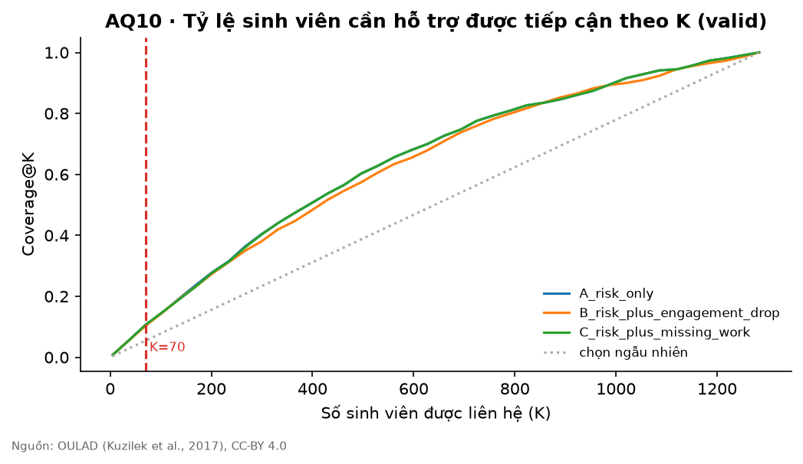
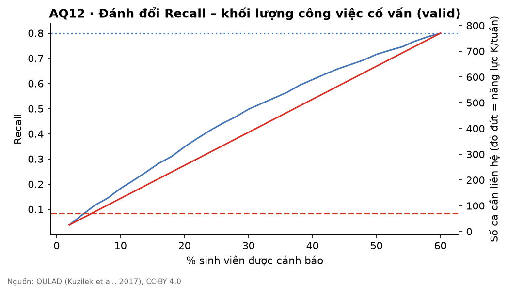

# Ưu tiên hỗ trợ – AQ10, AQ11, AQ12 (tự sinh)

Chọn trên **valid** ['2014B'] (n = 1283, cần hỗ trợ = 629). Test ['2014J'] (n = 1834, cần hỗ trợ = 717) chỉ để báo cáo và mô phỏng Risk List của học kỳ hiện tại. Sinh viên còn theo học tại ngày 41. Năng lực K = 35 × 2 cố vấn = **70 ca/tuần** (ASSUMPTION).

## AQ10 – So sánh phương án ưu tiên

Valid (dùng để chọn):

| strategy                    |   K |   coverage_at_K |   precision_at_K |
|:----------------------------|----:|----------------:|-----------------:|
| A_risk_only                 |  70 |           0.107 |            0.957 |
| B_risk_plus_engagement_drop |  70 |           0.103 |            0.929 |
| C_risk_plus_missing_work    |  70 |           0.107 |            0.957 |

Phương án chọn trên valid (Coverage@K cao nhất; hoà thì Precision@K, rồi phương án đơn giản hơn): **A_risk_only**.

Test (chỉ báo cáo, không dùng để chọn):

| strategy                    |   K |   coverage_at_K |   precision_at_K |
|:----------------------------|----:|----------------:|-----------------:|
| A_risk_only                 |  70 |           0.093 |            0.957 |
| B_risk_plus_engagement_drop |  70 |           0.093 |            0.957 |
| C_risk_plus_missing_work    |  70 |           0.093 |            0.957 |

## AQ12 – Kịch bản ngưỡng cảnh báo

Valid (nhóm chọn ngưỡng từ bảng này):

|   alert_share |   n_alerted |   recall |   precision |   false_alarms |   weeks_of_advisor_capacity | fits_capacity   |
|--------------:|------------:|---------:|------------:|---------------:|----------------------------:|:----------------|
|           0.1 |         128 |    0.183 |       0.898 |             13 |                        1.83 | False           |
|           0.2 |         257 |    0.35  |       0.856 |             37 |                        3.67 | False           |
|           0.3 |         385 |    0.499 |       0.816 |             71 |                        5.5  | False           |

Test (chỉ báo cáo):

|   alert_share |   n_alerted |   recall |   precision |   false_alarms |   weeks_of_advisor_capacity | fits_capacity   |
|--------------:|------------:|---------:|------------:|---------------:|----------------------------:|:----------------|
|           0.1 |         183 |    0.237 |       0.929 |             13 |                        2.61 | False           |
|           0.2 |         367 |    0.418 |       0.817 |             67 |                        5.24 | False           |
|           0.3 |         550 |    0.545 |       0.711 |            159 |                        7.86 | False           |

## AQ11 – Phân bố loại hỗ trợ đề xuất trong Risk List

| suggested_support                               |   count |
|:------------------------------------------------|--------:|
| Nhắc nhở có duyệt + hỏi thăm lý do chưa nộp bài |      37 |
| Mời tư vấn 1–1                                  |      29 |
| Gợi ý tài nguyên ôn tập theo concept            |       2 |
| Giới thiệu tutoring nhóm nhỏ                    |       2 |

> Risk List (`reports/risk_list.csv`) chỉ là đề xuất. Mọi dòng ở trạng thái `pending_review`; cố vấn phê duyệt trên dashboard trước bất kỳ liên hệ nào. Đây là đánh giá trên dữ liệu lịch sử, không chứng minh hiệu quả can thiệp.